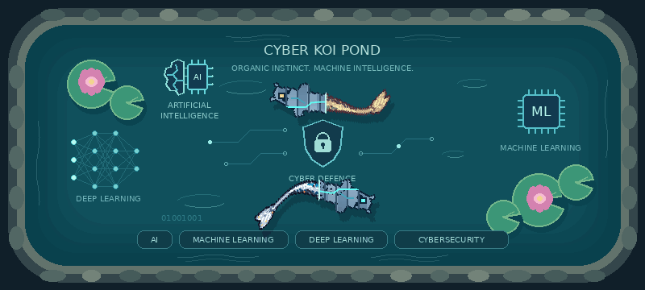

# Cyber Koi Pond

An animated pond for your GitHub profile, featuring a half-organic, half-robotic koi and visual references to AI, machine learning, deep learning and cybersecurity.

Created by **Dr Asegul Hulus (Ace)**. Built on **[git-koi](https://github.com/yalongwastaken/git-koi)** by **Anthony Yalong (@yalongwastaken)**.



The sample above uses AceVerse-Reboot's public activity. When you run the workflow in your own repository, git-koi generates your fish.

## What it does

- Uses git-koi to generate a fish from your public GitHub activity.
- Adds metallic armour and circuitry to half the fish.
- Animates it around a pond with lily pads, flowers and quiet shoreline waves.
- Includes an AI brain-and-chip emblem, a multilayer deep-learning motif, an ML chip and a cybersecurity shield.
- Updates nightly through GitHub Actions and commits only changed output.

**This is generative art using programmed rules.** The AI motifs are a visual theme. No learning model or security monitoring runs inside the pond. Upstream activity-derived colours and growth remain visible in the organic portion; the pond extension supplies the oval route rather than preserving upstream positional swimming behaviour exactly.

## Run this project on GitHub

1. Create a public repository named `cyber-koi-pond` and upload this project's contents, including `.github/workflows/pond.yml`.
2. Open **Actions → Cyber Koi Pond → Run workflow** on your default branch. Imported or forked workflows may need enabling first.
3. Wait for the green tick. The workflow writes `assets/pond.gif` using the repository owner's public activity.
4. In your profile repository (the public repository with exactly your username), add:

   ```html
   
   ```

   Replace `YOUR_USERNAME` and, if needed, the branch name. Your computer does not need to remain on. The built-in workflow token is used; no personal access token is required for the default public-data setup.

Keep the project folder structure intact. When uploading through a browser, check that the `.github` directory was included; some file pickers hide dot-prefixed directories. Branch protection or organisation restrictions can block the workflow's commit permission.

## Use the action directly in a profile repository

Once this project is published at `AceVerse-Reboot/cyber-koi-pond`, copy `examples/profile-workflow.yml` into your profile repository as `.github/workflows/pond.yml`. Copy `pond.json` too, then run the workflow. If you publish under a different owner or repository name, update the example's `uses:` reference.

Embed `assets/pond.gif` in that repository's README:

```html

```

The composite action renders files; the example workflow handles committing them. For reproducible dependencies, replace moving action references with reviewed commit SHAs or release tags. No release tag is assumed to exist in this starter project.

## Customise

Edit `pond.json`:

```json
{
  "title": "MY CYBER KOI POND",
  "subtitle": "ORGANIC INSTINCT. MACHINE INTELLIGENCE.",
  "theme": "teal",
  "robotic": true
}
```

| Setting | Choices or purpose |
| --- | --- |
| `title` | Pond heading; maximum 42 characters |
| `subtitle` | Short tagline; maximum 42 characters |
| `theme` | `teal`, `midnight`, `violet`; applies to the scenery |
| `robotic` | `true` for the robotic overlay, `false` for the organic fish |
| `ai_label_1`, `ai_label_2` | Two lines below the AI emblem |
| `deep_learning_label` | Label below the multilayer graph |
| `machine_learning_label` | Label below the ML chip |
| `cybersecurity_label` | Label below the shield |

Icon labels allow up to 22 characters. Shorter labels fit best; the four bottom topic badges remain fixed. Labels and title are rendered as text, not executed as code.

The action also accepts `login`, `body`, `config`, `output` and `token`. The default login is the repository owner. Upstream `body` choices are `white`, `black`, `asagi`, `tea`, `gold` and `platinum`.

## Run locally

Python 3.12 is used by the workflow. Install the dependency, then supply a transparent GIF generated by git-koi:

```bash
python -m pip install -r requirements.txt
python scripts/render_pond.py --input /path/to/koi.gif --output assets/pond.gif --config pond.json --still assets/pond.png
python -m unittest discover -s tests -v
```

To generate an input, follow [git-koi's getting-started guide](https://github.com/yalongwastaken/git-koi/blob/main/docs/getting-started.md). This project does not bundle its Rust executable.

The renderer writes the GIF to a temporary file before replacing the previous output. It exports an opaque 800 × 360 looping GIF with a shared palette to keep the download smaller. DejaVu Sans is used when available, with a Pillow fallback.

## Troubleshooting

- **Broken image:** confirm the workflow finished and the exact output path exists. On a slow connection, allow time for the GIF to download.
- **Old image:** GitHub or your browser may cache it. Refresh or change the image URL query after a design change.
- **Commit failed:** check branch protections and workflow write permissions. The example rebases before pushing to accommodate unrelated README edits.
- **Workflow stopped running:** GitHub can disable scheduled workflows in an inactive public repository; re-enable it in Actions. Schedule times are UTC and can be delayed.

## Credit and licence

Credit for the original activity-based koi belongs to **Anthony Yalong** and **git-koi**. Cyber Koi Pond is the scenery and styling extension by **Dr Asegul Hulus (Ace)**.

MIT licensed. See [LICENSE](LICENSE), [LICENSE.git-koi](LICENSE.git-koi) and [NOTICE.md](NOTICE.md). Contributions are welcome; see [CONTRIBUTING.md](CONTRIBUTING.md).
